# Scheduled Task Persistence Detection and Incident Investigation with Microsoft Sentinel

## Overview

This project demonstrates how Windows Scheduled Tasks can be used as a persistence mechanism and how this behavior can be detected, investigated, and remediated using Microsoft Sentinel.

The lab simulates the creation of a scheduled task on a Windows virtual machine, collects Windows Security Event ID `4698`, extracts useful task attributes from the event data, classifies suspicious scheduled task behavior, creates a Microsoft Sentinel analytics rule, generates a security incident, maps affected entities, and adds an automated analyst remediation task.

The project covers the full Blue Team workflow:

**Attack Simulation → Telemetry Collection → Detection → Alert → Incident → Investigation → Remediation → Automated Analyst Triage**

---

## Project Objectives

The main objectives of this project were to:

- simulate Windows Scheduled Task persistence in a controlled lab environment;
- collect scheduled task creation telemetry using Windows Security Event ID `4698`;
- extract scheduled task details from XML event data;
- identify potentially suspicious commands and task locations;
- create a KQL-based detection rule in Microsoft Sentinel;
- map affected host and account entities;
- generate and investigate a Microsoft Sentinel incident;
- manually remove the persistence mechanism;
- create an automation rule that assigns an analyst remediation task.

---

## Lab Environment

The project was built using:

- Microsoft Azure
- Windows Server virtual machine
- Azure Monitor Agent
- Data Collection Rule
- Log Analytics Workspace
- Microsoft Sentinel
- Windows Security Event Logs
- Kusto Query Language (KQL)

The Windows host used in the lab was:

`win-blue-team-lab`

The Sentinel workspace was:

`law-blue-team-lab`

---

## Audit Policy Validation

The Windows audit policy was checked to ensure that Object Access events required for Scheduled Task auditing were enabled.

```powershell
auditpol /get /subcategory:"Other Object Access Events"
```

The system returned:

`Success and Failure`

This confirmed that the host was capable of generating Scheduled Task audit events.


---

## Scheduled Task Persistence Simulation

A controlled Scheduled Task was created to simulate persistence behavior.

```powershell
schtasks /create /tn "BlueTeam-Lab-Persistence" /tr "cmd.exe /c echo Scheduled task executed > C:\Temp\scheduled-task-test.txt" /sc ONSTART /ru SYSTEM /f
```

The task was configured to:

- run at system startup;
- execute under the `SYSTEM` account;
- launch `cmd.exe`;
- write a harmless test string to a file.

The task configuration was then verified using:

```powershell
schtasks /query /tn "BlueTeam-Lab-Persistence" /fo LIST /v
```

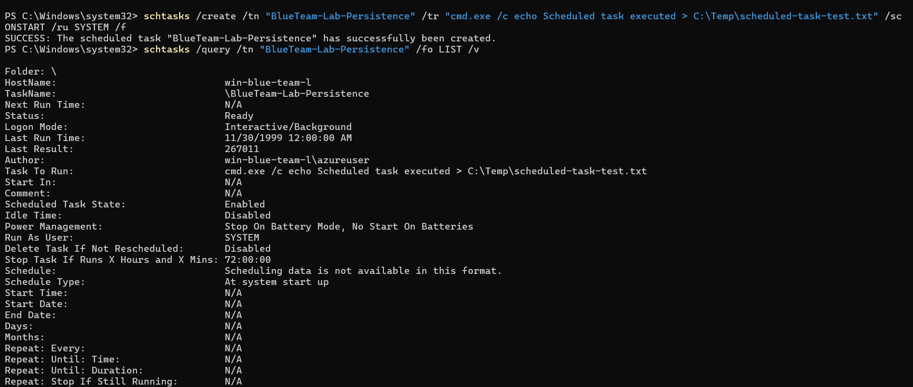

---

## Event ID 4698 Collection

Creation of the task generated Windows Security Event ID:

`4698 — A scheduled task was created`

The event was collected by the Azure Monitor Agent and ingested into the `SecurityEvent` table in Log Analytics.

```kql
SecurityEvent
| where TimeGenerated > ago(30m)
| where EventID == 4698
| project TimeGenerated, Computer, Account, EventID, Activity
| order by TimeGenerated desc
```

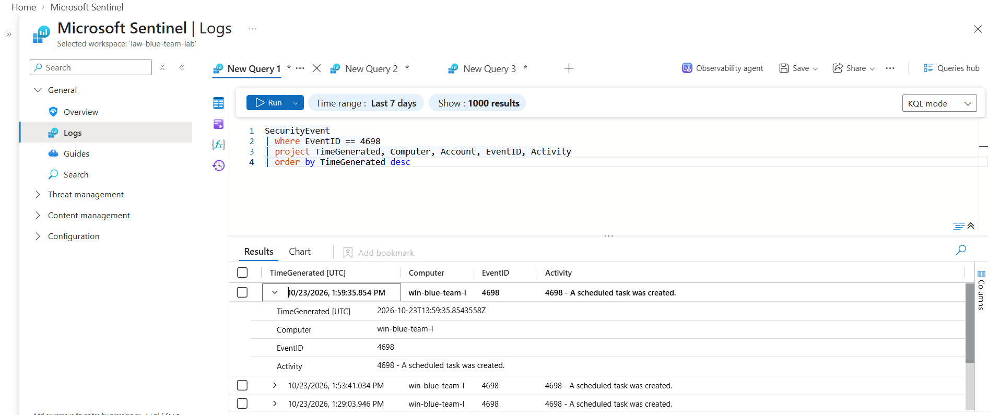

---

## Scheduled Task Event Parsing

The `EventData` field contains XML with details about the created task.

KQL was used to extract:

- creating user;
- domain;
- task name;
- task configuration XML.

```kql
SecurityEvent
| where TimeGenerated > ago(30m)
| where EventID == 4698
| extend SubjectUserName = extract(@'<Data Name="SubjectUserName">([^<]*)</Data>', 1, EventData)
| extend SubjectDomainName = extract(@'<Data Name="SubjectDomainName">([^<]*)</Data>', 1, EventData)
| extend TaskName = extract(@'<Data Name="TaskName">([^<]*)</Data>', 1, EventData)
| extend TaskContent = extract(@'<Data Name="TaskContent">([\s\S]*?)</Data>', 1, EventData)
| project TimeGenerated, Computer, SubjectDomainName, SubjectUserName, TaskName, TaskContent
| order by TimeGenerated desc
```

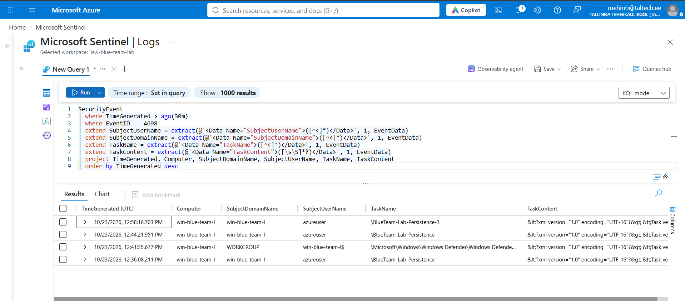

---

## Command and Argument Extraction

The task XML was decoded and parsed further to extract the executable, arguments, and task execution identity.

```kql
SecurityEvent
| where TimeGenerated > ago(30m)
| where EventID == 4698
| extend SubjectUserName = extract(@'<Data Name="SubjectUserName">([^<]*)</Data>', 1, EventData)
| extend TaskName = extract(@'<Data Name="TaskName">([^<]*)</Data>', 1, EventData)
| extend TaskContentRaw = extract(@'<Data Name="TaskContent">([\s\S]*?)</Data>', 1, EventData)
| extend TaskContent = replace_string(
    replace_string(
        replace_string(
            replace_string(TaskContentRaw, "&lt;", "<"),
            "&gt;", ">"
        ),
        "&quot;", "\""
    ),
    "&amp;", "&"
)
| extend Command = extract(@"<Command>([^<]+)</Command>", 1, TaskContent)
| extend Arguments = extract(@"<Arguments>([^<]+)</Arguments>", 1, TaskContent)
| extend RunAsUser = extract(@"<UserId>([^<]+)</UserId>", 1, TaskContent)
| project TimeGenerated, Computer, SubjectUserName, TaskName, Command, Arguments, RunAsUser
| order by TimeGenerated desc
```

The lab task was identified as:

- Command: `cmd.exe`
- RunAsUser: `S-1-5-18`
- `S-1-5-18` corresponds to the local `SYSTEM` account.

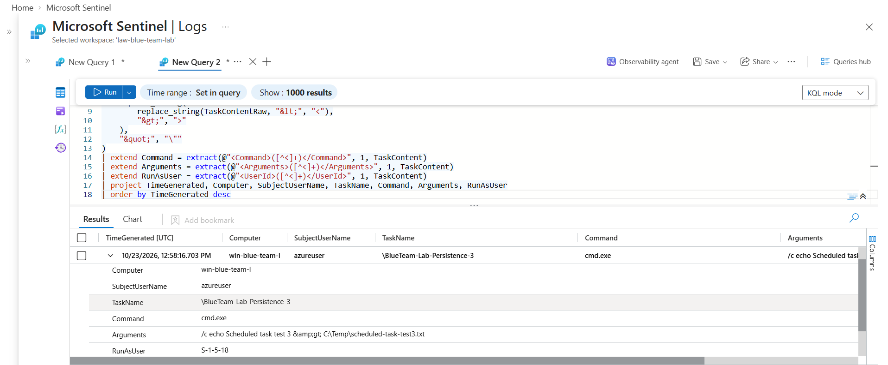

---

## Suspicious Scheduled Task Classification

The detection logic was expanded to identify common executable types associated with persistence and suspicious Scheduled Task behavior.

The rule classifies tasks using:

- PowerShell;
- command shell execution;
- script interpreters;
- common LOLBins;
- tasks created outside the Microsoft Scheduled Task namespace.

```kql
SecurityEvent
| where TimeGenerated > ago(30m)
| where EventID == 4698
| extend SubjectUserName = extract(@'<Data Name="SubjectUserName">([^<]*)</Data>', 1, EventData)
| extend TaskName = extract(@'<Data Name="TaskName">([^<]*)</Data>', 1, EventData)
| extend TaskContentRaw = extract(@'<Data Name="TaskContent">([\s\S]*?)</Data>', 1, EventData)
| extend TaskContent = replace_string(
    replace_string(
        replace_string(
            replace_string(TaskContentRaw, "&lt;", "<"),
            "&gt;", ">"
        ),
        "&quot;", "\""
    ),
    "&amp;", "&"
)
| extend Command = extract(@"<Command>([^<]+)</Command>", 1, TaskContent)
| extend Arguments = extract(@"<Arguments>([^<]+)</Arguments>", 1, TaskContent)
| extend RunAsUser = extract(@"<UserId>([^<]+)</UserId>", 1, TaskContent)
| extend SuspiciousReason = case(
    Command has_any ("powershell.exe", "pwsh.exe"), "PowerShell execution",
    Command has "cmd.exe", "Command shell execution",
    Command has_any ("wscript.exe", "cscript.exe"), "Script interpreter execution",
    Command has_any ("mshta.exe", "rundll32.exe", "regsvr32.exe"), "LOLBin execution",
    TaskName !startswith @"\Microsoft\", "Task outside Microsoft namespace",
    "Other"
)
| where SuspiciousReason != "Other"
| project TimeGenerated, Computer, SubjectUserName, TaskName, Command, Arguments, RunAsUser, SuspiciousReason
| order by TimeGenerated desc
```

The simulated task was classified as:

`Command shell execution`

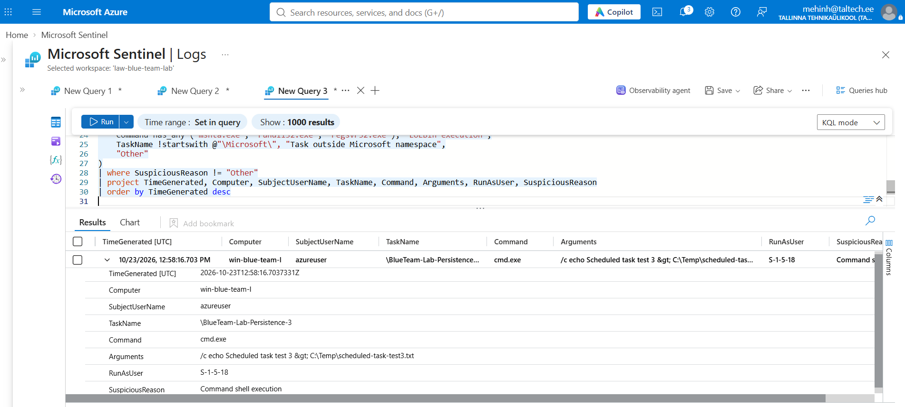

---

## Microsoft Sentinel Analytics Rule

A scheduled analytics rule was created:

**Name:** `Suspicious Scheduled Task Persistence`

**Severity:** High

**Status:** Enabled

**MITRE ATT&CK:**

- Tactic: Persistence
- Technique: T1053 — Scheduled Task/Job
- Sub-technique: T1053.005 — Scheduled Task

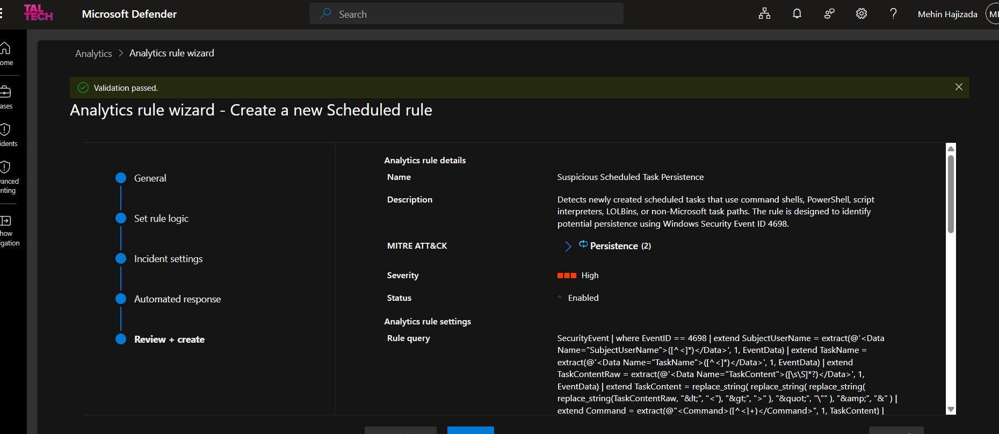

---

## Final Detection Query

The analytics rule uses the following KQL.

The explicit `ago()` time filter was removed because the Sentinel scheduled rule controls the detection window itself.

```kql
SecurityEvent
| where EventID == 4698
| extend SubjectUserName = extract(@'<Data Name="SubjectUserName">([^<]*)</Data>', 1, EventData)
| extend TaskName = extract(@'<Data Name="TaskName">([^<]*)</Data>', 1, EventData)
| extend TaskContentRaw = extract(@'<Data Name="TaskContent">([\s\S]*?)</Data>', 1, EventData)
| extend TaskContent = replace_string(
    replace_string(
        replace_string(
            replace_string(TaskContentRaw, "&lt;", "<"),
            "&gt;", ">"
        ),
        "&quot;", "\""
    ),
    "&amp;", "&"
)
| extend Command = extract(@"<Command>([^<]+)</Command>", 1, TaskContent)
| extend Arguments = extract(@"<Arguments>([^<]+)</Arguments>", 1, TaskContent)
| extend RunAsUser = extract(@"<UserId>([^<]+)</UserId>", 1, TaskContent)
| extend SuspiciousReason = case(
    Command has_any ("powershell.exe", "pwsh.exe"), "PowerShell execution",
    Command has "cmd.exe", "Command shell execution",
    Command has_any ("wscript.exe", "cscript.exe"), "Script interpreter execution",
    Command has_any ("mshta.exe", "rundll32.exe", "regsvr32.exe"), "LOLBin execution",
    TaskName !startswith @"\Microsoft\", "Task outside Microsoft namespace",
    "Other"
)
| where SuspiciousReason != "Other"
| project TimeGenerated, Computer, SubjectUserName, TaskName, Command, Arguments, RunAsUser, SuspiciousReason
```

---

## Rule Scheduling and Entity Mapping

The analytics rule was configured with:

- Run query every: `5 minutes`
- Lookup period: `10 minutes`
- Trigger when query returns: `more than 0 results`
- Event grouping: `one alert per event`
- Suppression: disabled

Entity mapping:

**Host**
- Identifier: `HostName`
- Value: `Computer`

**Account**
- Identifier: `Name`
- Value: `SubjectUserName`

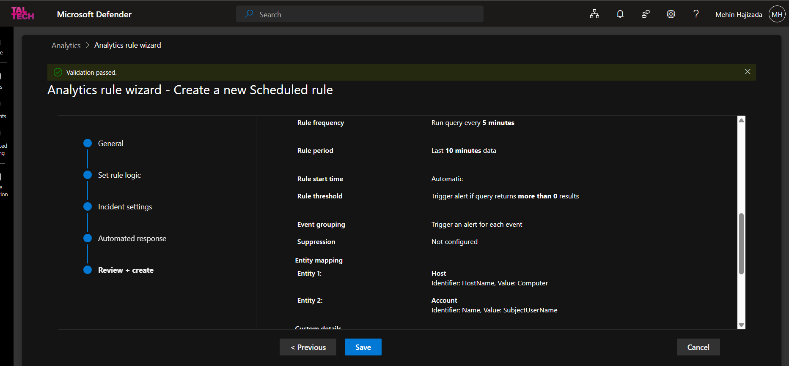

---

## Final Detection Validation

A new Scheduled Task was created after the analytics rule had been enabled.

The resulting Event ID `4698` was successfully ingested and identified in Sentinel.

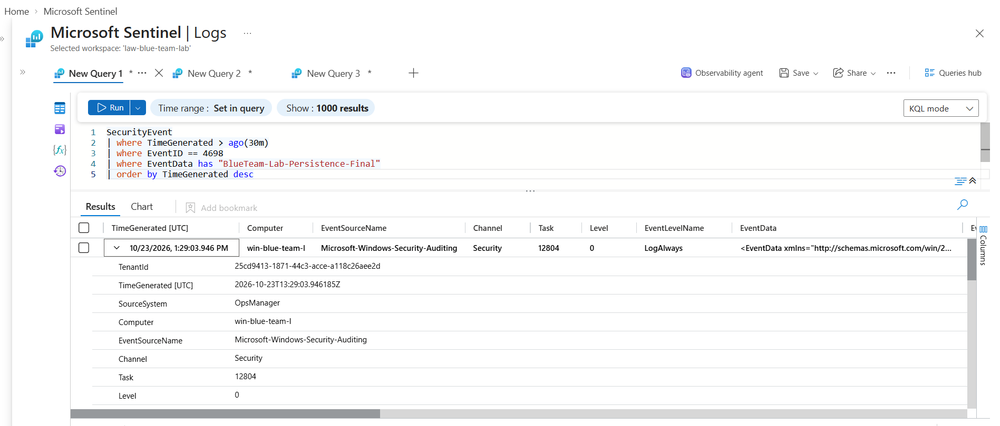

---

## Incident Generation

The analytics rule generated a High severity Microsoft Sentinel incident:

`Suspicious Scheduled Task Persistence`

The incident was categorized under Persistence and mapped to the Scheduled Task MITRE technique.

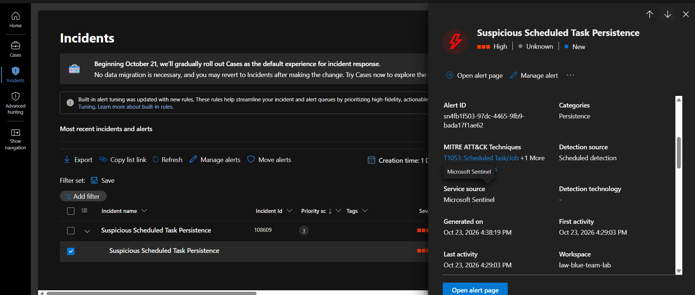

---

## Incident Investigation

The incident investigation graph identified two affected entities:

- Host: `win-blue-team-lab`
- Account: `azureuser`

This allows an analyst to quickly determine the endpoint and account associated with the suspicious Scheduled Task creation.

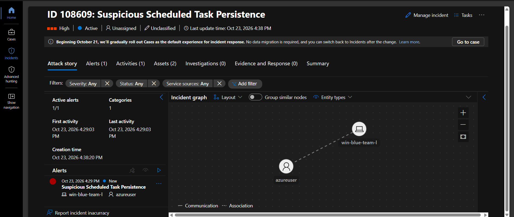

---

## Investigation Approach

During investigation, an analyst should review:

1. Scheduled task name.
2. Command being executed.
3. Command-line arguments.
4. User that created the task.
5. Account used to execute the task.
6. Scheduled trigger.
7. Related process execution.
8. Authentication activity around the same time.
9. Similar Scheduled Tasks on the same endpoint.
10. Whether the task is expected administrative activity.

Additional telemetry such as endpoint detection data, process creation logs, PowerShell logging, and network activity can improve investigation accuracy.

---

## Manual Remediation

After investigation, the controlled persistence mechanism was manually removed from the endpoint.

```powershell
schtasks /delete /tn "BlueTeam-Lab-Persistence-Final" /f
```

The task was then queried again to verify that it no longer existed.

The test artifact was also removed:

```powershell
Remove-Item "C:\Temp\scheduled-task-final.txt" -ErrorAction SilentlyContinue
```

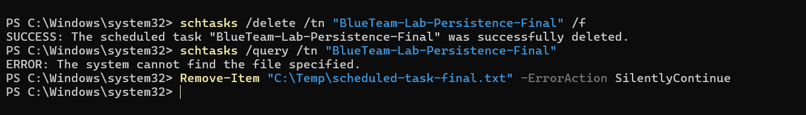

This remediation was performed manually after analyst validation.

The lab used the same controlled VM for both attack simulation and defender response activities.

---

## Automated Analyst Triage

A Microsoft Sentinel automation rule was created:

**Automation rule name:**  
`Scheduled-Task-Persistence-Triage`

**Trigger:**  
`When incident is created`

**Condition:**  
Analytics rule name contains `Suspicious Scheduled Task Persistence`

**Action:**  
`Add task`

**Task title:**  
`Validate and remove suspicious scheduled task`

The task instructs the analyst to review the scheduled task, command, arguments, host, and account before deciding whether removal or further containment is required.

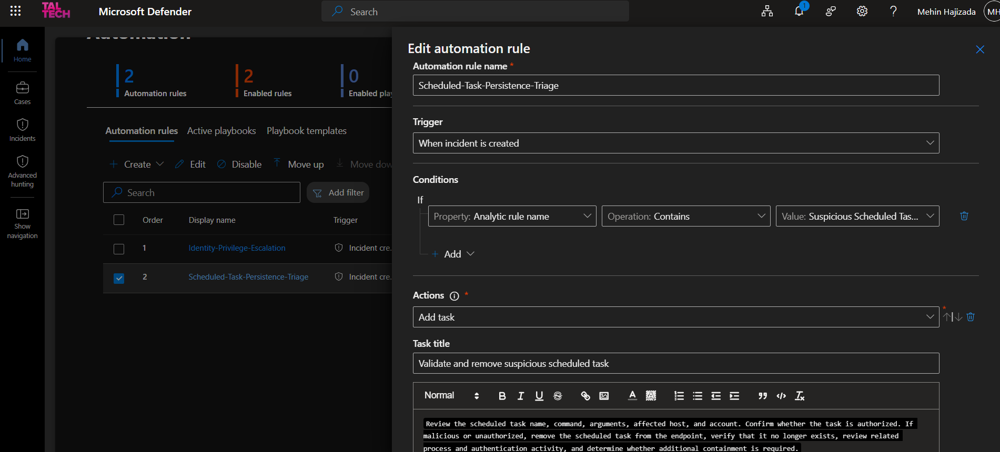

---

## Automation Validation

After the automation rule was enabled, additional controlled Scheduled Task activity generated new Sentinel incidents.

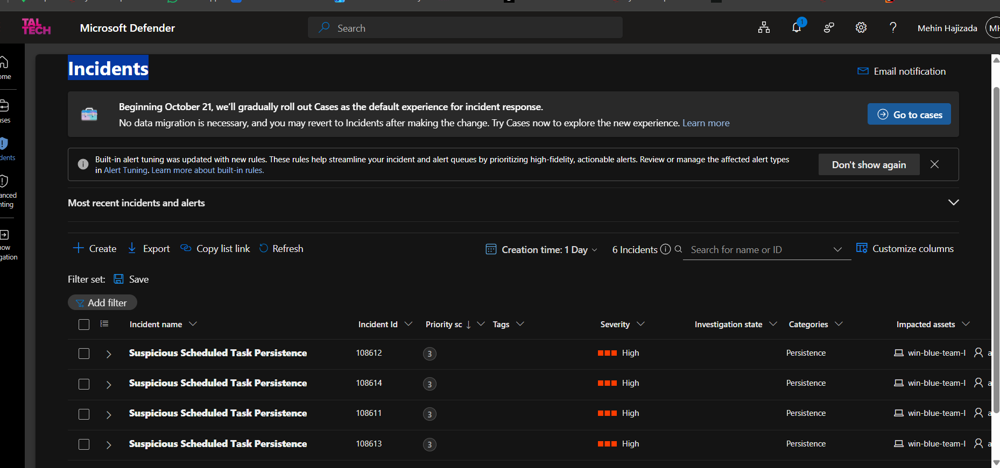

The newly generated incident automatically contained the analyst remediation task.

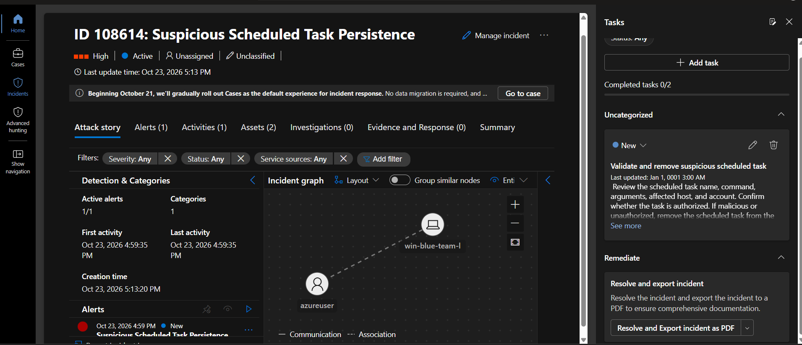

This demonstrates an automated SOC triage workflow without automatically performing a potentially destructive remediation action.

---

## Detection Limitations

The detection is intentionally broad for lab purposes.

Potential false positives include:

- legitimate administrative Scheduled Tasks;
- enterprise management tools;
- software installers;
- backup tools;
- monitoring agents;
- legitimate scripts using PowerShell or command shells.

A production detection should be improved using:

- known-good task allowlists;
- trusted administrative accounts;
- task path baselines;
- command-line reputation;
- parent process context;
- endpoint detection telemetry;
- task creation frequency;
- known software deployment tools;
- signer and file reputation;
- user behavior baselines.

The detection should not automatically remove Scheduled Tasks without validation because legitimate tasks may match the same behavioral indicators.

---

## MITRE ATT&CK Mapping

This project maps primarily to:

**T1053.005 — Scheduled Task/Job: Scheduled Task**

Tactic:

**Persistence**

Scheduled Tasks can allow malicious code to execute automatically at system startup, user logon, or another configured trigger.

---

## Key Findings

The project demonstrated that:

- Windows Security Event ID `4698` provides useful Scheduled Task creation telemetry;
- XML data inside the event can be parsed with KQL;
- task name, command, arguments, user, and execution identity can be extracted;
- suspicious Scheduled Task behaviors can be classified;
- Sentinel analytics rules can generate incidents from this telemetry;
- Host and Account entity mapping improves investigation context;
- manual remediation can remove the persistence mechanism;
- Sentinel automation can assign a standardized analyst remediation task.

---

## Repository Structure

```text
sentinel-scheduled-task-persistence/
├── README.md
├── incident-report.md
├── queries/
│   └── scheduled-task-persistence.kql
└── screenshots/
    ├── 01-audit-policy-validation.png
    ├── 02-scheduled-task-created.png
    ├── 03-event-4698-ingested.png
    ├── 04-scheduled-task-event-parsing.png
    ├── 05-scheduled-task-command-extraction.png
    ├── 06-suspicious-scheduled-task-classification.png
    ├── 07-analytics-rule-overview.png
    ├── 08-analytics-rule-scheduling-and-entities.png
    ├── 09-final-scheduled-task-event.png
    ├── 10-scheduled-task-persistence-incident.png
    ├── 11-incident-investigation-entities.png
    ├── 12-scheduled-task-remediation.png
    ├── 13-automation-rule-investigation-task.png
    ├── 14-new-scheduled-task-incidents.png
    └── 15-final-incident-with-automation-task.png
```

---

## Skills Demonstrated

This project demonstrates practical experience with:

- Microsoft Sentinel
- Microsoft Defender portal
- Azure Monitor Agent
- Log Analytics
- Windows Security auditing
- Windows Scheduled Tasks
- KQL
- XML event parsing
- detection engineering
- MITRE ATT&CK mapping
- entity mapping
- incident investigation
- persistence detection
- manual remediation
- Sentinel automation rules
- SOC triage workflows

---

## Future Improvements

Future improvements could include:

- correlating Event ID `4698` with process creation Event ID `4688`;
- monitoring Scheduled Task modification and deletion events;
- detecting encoded PowerShell inside Scheduled Tasks;
- adding file and command reputation checks;
- adding known-good task baselines;
- integrating endpoint detection telemetry;
- creating more advanced Sentinel playbooks for containment;
- correlating persistence activity with authentication and privilege escalation events.

---

## Conclusion

This project demonstrates an end-to-end Blue Team detection and response workflow for Windows Scheduled Task persistence.

A controlled persistence technique was simulated, collected through Windows Security auditing, analyzed using KQL, detected with a Microsoft Sentinel analytics rule, investigated through mapped entities, manually remediated, and enhanced with automated analyst triage.

The result is a reusable detection workflow that demonstrates practical SOC investigation, detection engineering, incident response, and remediation skills.
